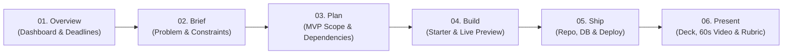

# Phase 1: HackStack Screen-by-Screen UX Blueprint & Domain Contracts

**Project**: HackStack (Team Blue10.1 — NST-ADYPU)  
**Status**: Architecture & UX Deliverable (Step 5 of Section 18 Handoff)  
**Target Audience**: 2nd–3rd year engineering students on 2–3 person hackathon teams.  
**Core Thesis**: Turn a problem statement into a feasible MVP, a runnable starter codebase, and evidence-backed submission — with or without AI.

---

## 1. Decisions vs. Assumptions

To maintain strict architectural honesty, all items are tagged:
- **[Confirmed Decision]**: Verified by user input, working source code, or committed rules.
- **[Proposed / Open Assumption]**: Recommended specification awaiting validation or user testing.

| Aspect | Status | Details |
|---|---|---|
| **Execution Model** | [Confirmed Decision] | Guided planning + downloadable starter repo + student's own IDE (no in-browser container/IDE initially). |
| **Safety & Routing Engine** | [Confirmed Decision] | JEV (TypeSafe AI System One) acts as pre-flight classifier (<500ms) for content safety, brief quality, and model complexity routing; fallback to in-process heuristics when offline/unkeyed. |
| **Starter Architecture** | [Confirmed Decision] | Golden Next.js (App Router) + Prisma + PostgreSQL + Vitest + Tailwind. Zod validation on all boundaries. |
| **Credentials & Security** | [Confirmed Decision] | Server keys never sent to caller-controlled URLs or client bundles. BYOK tokens stored in browser session memory only. |
| **Navigation Structure** | [Proposed Specification] | Transition from 4 linear tabs (`Preview`, `Code`, `Deck`, `Demo`) to a 6-stage nonlinear lifecycle (`Overview`, `Brief`, `Plan`, `Build`, `Ship`, `Present`). |
| **Persistence Hierarchy** | [Proposed Specification] | Browser `localStorage` (rapid unsaved recovery) → Supabase relational project store (collaborative, team-shared). |

---

## 2. Global Design System & Tokens

Following the project rules (`GEMINI.md`), HackStack uses a developer-dark, high-contrast palette:

```
Obsidian Canvas:  #090D16  (--surface-0: 8 11 18)
Surface Elevated: #0D111A  (--surface-1: 13 17 26)
Card / Border:    #141A25  (--surface-2: 20 26 37)
Line / Subtle:    #222A37  (--line: 34 42 55)
Line Strong:      #434F60  (--line-strong: 67 79 96)
Emerald Accent:   #10B981  (--accent: 45 212 191)
Text Dominant:    #F8FAFC  (--fg: 248 250 252)
Text Secondary:   #CBD5E1  (--fg-2: 203 213 225)
Text Muted:       #94A3B8  (--fg-3: 148 163 184)
Typography:       Inter (UI text), JetBrains Mono (code, timestamps, metrics)
```

---

## 3. Screen-by-Screen UX Blueprint



### Screen 1: Overview (Command & Health)
* **Goal**: Show immediate progress, next high-leverage action, and deadline countdown.
* **Layout**:
  * **Header**: Project name, active team members, save indicator (`Local Draft` / `Synced to Supabase`), time remaining to freeze.
  * **Hero Action Card**: "Next suggested milestone" (e.g., *"Make starter test pass in starter.test.ts"* with 1-click jump to file).
  * **Health Grid**:
    * Schema Validated (Zod status)
    * Code Quality (Static check pass/fail)
    * Team Velocity (Tasks completed vs total)
    * Evidence Lock (Screenshots, test proofs attached)

### Screen 2: Brief (Problem & Scope)
* **Goal**: Force clarity on *who* has the problem and *what* makes the solution unique before code is touched.
* **Layout**:
  * **Central Prompt**: *"What problem is your team solving?"*
  * **Input Elements**:
    * 2-sentence problem statement.
    * Target User Persona dropdown/chips (e.g., *Campus residential students*, *Emergency medical staff*).
    * Event constraints & submission rules (timezone, allowed tech, AI usage policy).
  * **JEV Instant Feedback Badge**:
    * 🟢 *Safe & Feasible* (Confidence: 94%)
    * 🟡 *Vague Brief Alert* (Advice: *"Specify who pays and who delivers"*).
    * Recommended Model: `Gemini 3.5 Flash` (Complex real-time features detected).

### Screen 3: Plan (MVP Scoping & Dependency Tree)
* **Goal**: Prevent 3 AM scope bloat by categorizing features into Must / Nice / Cut.
* **Layout**:
  * **Kanban / Bucket Grid**:
    1. **Must-Have (Core MVP)**: Hard cap at 3 features (e.g., *UPI Escrow Hold, Syllabus Match, QR Handshake*).
    2. **Nice-to-Have (Stretch)**: Locked until core features have passing tests.
    3. **Cut (Explicit Non-Goals)**: Documented to defend scope during judge Q&A.
  * **Deterministic Schedule Estimator**: Rule-based feasibility check (Hours available vs complexity score).

### Screen 4: Build (The Studio — Live Preview & Code)
* **Goal**: Unified workspace connecting interactive UI mockup with downloadable starter code.
* **Layout**:
  * **Left/Top Switcher**:
    * **Sub-Tab A: Interactive Preview**:
      * Live schema-driven metrics table.
      * Live filter search.
      * `+ Quick Action` modal to add records into active state.
      * Reset button (restores clean baseline without wiping pitch changes).
    * **Sub-Tab B: Code & Schemas**:
      * File tree (`prisma/schema.prisma`, `route.ts`, `starter.test.ts`, `README.md`, `.env.example`).
      * Syntax-highlighted viewer with 1-click copy.
      * **1-Click Eject (.zip)**: Generates complete runnable Next.js starter repo.

### Screen 5: Ship (Git, Database & Deployment)
* **Goal**: Guide students through turning raw code into a public, judge-accessible URL.
* **Layout**:
  * **Step 1: GitHub Connect**: Initialize repo with README and license, or push to existing.
  * **Step 2: Database Setup**: 1-click copy connection string guidelines for Supabase / Neon PostgreSQL.
  * **Step 3: Vercel Deploy**: Deployment status indicator, environment variable checklist.
  * **Safety Barrier**: Explicit permission gates before external repo/deployment actions.

### Screen 6: Present (Pitch Deck & Demo Kit)
* **Goal**: Deliver a stage-ready pitch and 60-second backup video with zero manual formatting.
* **Layout**:
  * **10-Slide Pitch Carousel**: CoNSTruct structure (Hook, Problem, Persona, Solution, AI Depth, Architecture, Live Flow, GTM, Guardrails, Ask). Arrow navigation + speaker notes.
  * **60s Teleprompter**: 4 timestamped 15-second blocks with clear voiceover scripts.
  * **Native Screen Recorder**: In-browser display media recording with countdown timer and `.webm` instant export.
  * **Judge Rubric Checklist**: Ranked CoNSTruct scoring rubric with live readiness percentage.

---

## 4. Domain Data Contracts (TypeScript Schemas)

These contracts evolve `HackStackOutput` from a monolithic blob into composable, versioned entities:

```typescript
import { z } from "zod";

// 1. Project & Workspace Entity
export const WorkspaceMetaSchema = z.object({
  id: z.string().uuid(),
  title: z.string().min(2).max(100),
  tagline: z.string().max(200),
  targetDeadline: z.string().datetime().optional(),
  activePresetId: z.string().nullable(),
  version: z.number().int().nonnegative().default(1),
  updatedAt: z.string().datetime(),
});

// 2. Brief & Constraints Contract
export const ProjectBriefSchema = z.object({
  problemStatement: z.string().min(10).max(2000),
  targetPersona: z.string().min(3).max(100),
  stackSelection: z.string().min(2),
  constraints: z.array(z.string()).default([]),
  jevClassification: z.object({
    safety: z.enum(["allow", "allow_warn", "block"]),
    complexity: z.enum(["simple", "moderate", "complex"]),
    recommendedModel: z.string(),
    confidence: z.number().min(0).max(1),
  }).optional(),
});

// 3. Feature & Scope Contract
export const FeatureItemSchema = z.object({
  id: z.string().cuid(),
  title: z.string().min(2),
  description: z.string().optional(),
  category: z.enum(["must", "nice", "cut"]),
  completed: z.boolean().default(false),
  acceptanceCriteria: z.array(z.string()).min(1),
  linkedFiles: z.array(z.string()).default([]),
});

// 4. Verification & System Evidence Contract
export const VerificationEvidenceSchema = z.object({
  type: z.enum(["vitest_unit", "prisma_schema", "browser_recording", "vercel_deploy"]),
  status: z.enum(["passed", "failed", "pending", "skipped"]),
  summary: z.string(),
  recordedAt: z.string().datetime(),
  artifactReference: z.string().optional(),
});
```

---

## 5. UI State Machine: Error, Conflict & Recovery Matrix

| State | User Experience | Recovery Action |
|---|---|---|
| **Missing API Key** | Warning banner on Generate action; live sample presets stay 100% interactive. | 1-click load built-in preset or input custom key in header. Current work never lost. |
| **Model Rejection (429/503)** | Immediate error banner showing provider code; workspace retains current state and baseline. | Automatic rotation to fallback model or 1-click retry. |
| **Unsaved Edits Conflict** | Yellow badge indicating local draft differs from remote Supabase snapshot. | Modal: *"Review diff"* with choices: `Keep Local`, `Overwrite Cloud`, `Duplicate Project`. |
| **Preview Row Added** | Local state updates instantly, first metric increments, reset baseline preserved. | Click `Reset Preview` to revert rows without affecting pitch deck or code files. |
